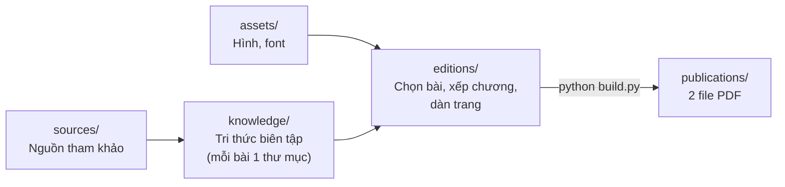

# Algorithmic Puzzles: Hệ tri thức câu đố giải thuật

Đây là nơi sưu tầm, biên tập và xuất bản những câu đố giải thuật hay. Mục tiêu là rèn tư duy, sự sáng tạo và cảm giác "à, ra thế!" cho học sinh, sinh viên. Dự án được tổ chức như một **hệ tri thức**: mỗi câu đố là một đơn vị tri thức có ID ổn định, có lời giải, nhãn kiến thức, nguồn và trạng thái review. Nhờ vậy, câu đố có thể được truy xuất và dùng lại cho nhiều ấn phẩm, đề thi hay bài giảng khác nhau.

## Tải về

| Tài liệu | File |
|---|---|
| Bản sinh viên: đề và tranh minh họa | [publications/algorithmic-puzzles-student.pdf](publications/algorithmic-puzzles-student.pdf) |
| Bản giảng viên: đáp số, hướng giải, ghi chú sư phạm | [publications/algorithmic-puzzles-instructor.pdf](publications/algorithmic-puzzles-instructor.pdf) |

Hiện có 60 bài, chia ba phần: chiến lược & thông tin, trò chơi, thiết kế giải thuật. Ngân hàng sẽ tiếp tục được mở rộng. Danh sách 72 ứng viên đang chờ biên tập nằm trong [sources/candidates](sources/candidates/catalog-72-v0.1.md).

---

## 1. Kiến trúc: Nguồn → Tri thức → Ấn phẩm



Mỗi tầng chỉ đọc từ tầng đứng trước nó. Build **không bao giờ** sửa `knowledge/`, `sources/` hay `assets/`; có test kiểm tra điều này bằng checksum.

```text
algorithmic-puzzles/
├── README.md · CONTRIBUTING.md · AGENTS.md
├── project.json            sổ đăng ký đường dẫn của hệ thống
├── build.py                điểm vào build PDF
│
├── sources/                ① NGUỒN
│   ├── registry.json           danh mục nguồn + SHA-256
│   ├── technical-references.json
│   └── candidates/             ứng viên chưa biên tập (catalog 72 bài)
│
├── knowledge/              ② TRI THỨC: nguồn chính của nội dung
│   ├── puzzles/
│   │   ├── INDEX.md            mục lục (sinh tự động)
│   │   └── PZ-0001/
│   │       ├── puzzle.json     đề, dữ kiện, độ khó, nhãn kiến thức
│   │       ├── solution.json   đáp số, hướng giải, ghi chú dạy học
│   │       ├── review.json     trạng thái review
│   │       └── provenance.json nguồn, tác giả
│   ├── taxonomy.json           concept / technique / cognitive level
│   ├── cards/                  knowledge cards: nguyên lý dùng lại được
│   └── difficulty-rubric.md
│
├── editions/               ③ CẤU HÌNH ẤN PHẨM
│   └── classroom/              edition.json · renderer.py · TYPOGRAPHY.md
│
├── publications/           ④ THÀNH PHẨM: chỉ chứa 2 PDF
│
├── assets/                 figures/ · masters/ (PNG gốc) · fonts/
├── docs/                   phong cách biên tập, mô hình dữ liệu, toolchain
├── tools/                  CLI + thư viện Python (chỉ dùng thư viện chuẩn)
└── tests/                  kiểm thử dữ liệu, đáp số, quy trình build
```

---

## 2. Môi trường

| Thành phần | Phiên bản | Dùng cho | Bắt buộc? |
|---|---|---|---|
| **Python** | ≥ 3.11 (đã kiểm tra trên 3.14) | validate, tìm kiếm, render, test | Có. Chỉ dùng thư viện chuẩn, không cần `pip install` |
| **XeLaTeX** | MiKTeX ≥ 25 hoặc TeX Live ≥ 2024 | biên dịch PDF | Chỉ khi cần build PDF |
| **Git** | bất kỳ | cộng tác | Có |
| Font | có sẵn trong `assets/fonts/` | PDF | Không cần cài vào máy |

Các gói LaTeX cần có: `fontspec geometry amsmath amssymb mathtools booktabs enumitem needspace tikz xcolor graphicx fancyhdr lastpage titlesec hyperref adjustbox wrapfig`.

**Windows**

```powershell
winget install Python.Python.3.13 Git.Git
python tools/setup_tex.py      # cài MiKTeX dùng chung, bật tự cài gói thiếu; sau đó mở lại terminal
```

**Linux (Debian/Ubuntu)**

```bash
sudo apt install python3 git texlive-xetex texlive-latex-extra texlive-pictures texlive-fonts-recommended
```

**macOS**

```bash
brew install python git && brew install --cask mactex-no-gui
```

Chi tiết: [docs/toolchain.md](docs/toolchain.md).

---

## 3. Cài đặt và build

```bash
git clone <url-repo> algorithmic-puzzles && cd algorithmic-puzzles
python tools/puzzles.py validate          # kiểm tra toàn vẹn dữ liệu (~1 giây)
python -m unittest discover -s tests      # kiểm thử: dữ liệu, đáp số, quy trình build
python build.py                           # dựng và phát hành 2 PDF vào publications/ (~1 phút)
python build.py --render-only             # chỉ sinh LaTeX vào build/, không cần XeLaTeX
python build.py --no-release              # biên dịch PDF nhưng chỉ để trong build/
```

Chỉ khi biên dịch **thành công cả hai bản** thì PDF trong `publications/` mới được thay. Log, LaTeX trung gian và manifest checksum nằm trong `build/` (bị ignore).

---

## 4. Truy xuất tri thức

```bash
python tools/puzzles.py search "quy hoạch động"          # gõ không dấu cũng được
python tools/puzzles.py search --technique T-interval-dp
python tools/puzzles.py search --concept C-games --difficulty 3 --json
python tools/puzzles.py show PZ-0025                     # toàn bộ hồ sơ của một bài
python tools/puzzles.py stats
python tools/puzzles.py index                            # sinh lại knowledge/puzzles/INDEX.md
```

Để duyệt nhanh trên GitHub, mở [knowledge/puzzles/INDEX.md](knowledge/puzzles/INDEX.md).

---

## 5. Thêm bài mới và làm ấn phẩm mới

```bash
python tools/puzzles.py new "Tên câu đố" --author "Tên giảng viên"   # tạo thư mục bài với ID kế tiếp
```

Quy trình đầy đủ, quy ước review và cách xử lý khi hai người cùng tạo một ID: xem **[CONTRIBUTING.md](CONTRIBUTING.md)**.

Ấn phẩm không gắn với số bài. Số bài trên bìa được tự lấy theo danh sách đã chọn, nên khi thêm bài chỉ cần sửa `editions/classroom/edition.json`. Muốn làm ấn phẩm khác (ví dụ bản olympiad hay workshop), xem [editions/README.md](editions/README.md).

---

## 6. Tài liệu

| Chủ đề | Tài liệu |
|---|---|
| Nguyên tắc biên tập đề, hình và hai bản PDF | [docs/editorial-style.md](docs/editorial-style.md) |
| Ý nghĩa từng trường dữ liệu | [docs/data-model.md](docs/data-model.md) |
| Cài đặt và đối chiếu XeLaTeX | [docs/toolchain.md](docs/toolchain.md) |
| Mô hình tri thức, taxonomy, knowledge cards | [knowledge/README.md](knowledge/README.md) |
| Rubric độ khó | [knowledge/difficulty-rubric.md](knowledge/difficulty-rubric.md) |
| Nguồn tham khảo | [sources/README.md](sources/README.md) |
| Ấn phẩm và dàn trang | [editions/README.md](editions/README.md) |
| Hình minh họa | [assets/README.md](assets/README.md) |

## 7. Trạng thái chất lượng

- Đáp số của toàn bộ bài đã được kiểm bằng chương trình ([tests/test_puzzle_answers.py](tests/test_puzzle_answers.py)). Lời giải hiện ở mức `draft` và **chưa được thẩm định độc lập**.
- Số sao là đề xuất, cần hiệu chuẩn bằng phản hồi từ lớp học. Prerequisites và cognitive demand chưa được đánh giá.
- Nhãn concept/technique đang ở trạng thái `suggested`. Muốn nâng lên `reviewed` phải ghi tên người review và ngày review; validator bắt buộc điều này.
